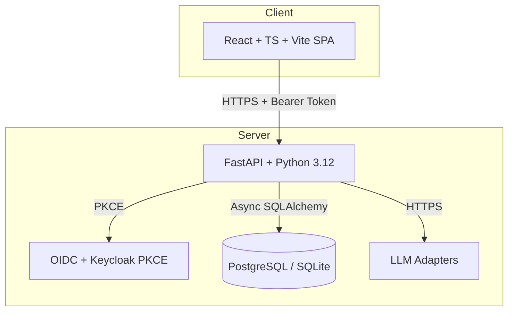

# atlas-pilot-alan-vo | AI & Machine Learning

> Work in progress. This checkpoint may be incomplete or fail tests. See PLAN.md and STATUS.md before use.


An AI agent evaluation and management platform for developers building AI/ML applications. Enables systematic evaluation of AI agents against reproducible benchmarks, with a catalog for discovering, importing, and managing specialized agents.

## The Problem

AI agent development lacks standardized evaluation. Developers build custom agents for coding, research, analysis, and automation, but have no systematic way to measure quality, compare approaches, or regress against benchmarks. This leads to ad-hoc prompting, inconsistent results, and difficulty sharing effective agents across teams.

## The Approach

atlas-pilot-alan-vo provides:

1. **Agent Catalog** — Import, version, and manage agent definitions (Markdown, JSON) with metadata, categories, and search
2. **Evaluation Engine** — Define deterministic criteria, run evaluations against recorded agent responses, score 0–100, compare side-by-side
3. **LLM Adapter Framework** — Unified interface for OpenAI-compatible, Anthropic, Gemini, and Ollama providers; keys stay server-side

All core evaluation logic runs offline without LLM keys. LLM explanations are opt-in, labeled advisory, and grounded in actual evaluation records.

## Architecture



## Quick Start

### Prerequisites
- Docker 24+ and Docker Compose 2+
- Or: Python 3.12, Node 24, PostgreSQL 16, Keycloak 25

### With Docker Compose (Recommended)

```bash
cp .env.example .env
# Edit .env with your keys (LLM_API_KEY, KEYCLOAK_CLIENT_SECRET, SECRET_KEY)
docker compose up --build
```

Services:
- Frontend: http://localhost
- Backend API: http://localhost:8000/api/v1
- API Docs: http://localhost:8000/api/v1/docs
- Keycloak Admin: http://localhost:8080 (admin/admin)

### Local Development

```bash
# Backend
python3 -m venv .venv
source .venv/bin/activate
pip install -r backend/requirements.txt
cp .env.example .env
# Edit .env
uvicorn app.main:app --reload --host 0.0.0.0 --port 8000

# Frontend (separate terminal)
cd frontend
npm install
npm run dev
```

## Testing

```bash
# Backend tests
source .venv/bin/activate
PYTHONPATH=backend python -m pytest backend/tests -v

# Frontend tests
cd frontend
npm run test
```

## API Endpoints

| Method | Path | Description |
|--------|------|-------------|
| GET | /api/v1/health | Health check |
| GET | /api/v1/agents | List agents (paginated, filterable) |
| POST | /api/v1/agents | Create agent |
| GET | /api/v1/agents/{id} | Get agent detail |
| PUT | /api/v1/agents/{id} | Update agent |
| DELETE | /api/v1/agents/{id} | Delete agent |
| POST | /api/v1/agents/import | Import agents from Markdown/JSON |
| GET | /api/v1/agents/export | Export agents |
| GET | /api/v1/evaluations | List evaluations |
| POST | /api/v1/evaluations | Create evaluation |
| GET | /api/v1/evaluations/{id} | Get evaluation detail |

## AI/ML Evaluation

The evaluation engine uses deterministic, reproducible criteria:

- **Factuality** — Does the agent's output match ground truth?
- **Completeness** — Does it cover all required aspects?
- **Relevance** — Does it address the actual question/task?
- **Consistency** — Same input yields equivalent quality output?
- **Safety** — No hallucinated commands, secrets, or harmful actions?

Run evaluations:

```bash
# CLI (planned)
atlas-pilot evaluate --agent ai-engineer --criteria factuality,completeness --dataset benchmarks/coding.jsonl
```

Results are stored in the database with scores (0–100), details, and timestamps for regression tracking.

### Limitations

- No live LLM calls in CI; all provider calls mocked
- Evaluation criteria are hand-coded heuristics, not learned metrics
- Benchmark datasets are small and domain-specific
- No statistical significance testing yet

## Security

- OIDC authorization code flow with PKCE via Keycloak
- Access tokens stored in memory only (SPA), never localStorage
- HttpOnly SameSite cookies for session management (alternative arch)
- All data endpoints require valid JWT with role validation
- LLM API keys never leave server; bounded timeouts, redacted errors
- No hardcoded secrets; all credentials via environment variables

### SSO / SAML Setup

Keycloak supports upstream SAML/OIDC identity brokering:

1. Configure Identity Provider in Keycloak Admin Console
2. Add SAML/OIDC provider with your IdP metadata
3. Map IdP roles to realm roles (viewer, operator, admin)
4. Update `KEYCLOAK_URL`, `KEYCLOAK_REALM` in `.env`

## Configuration

| Variable | Description | Required |
|----------|-------------|----------|
| DATABASE_URL | PostgreSQL/SQLite connection string | Yes |
| KEYCLOAK_URL | Keycloak base URL | Yes |
| KEYCLOAK_REALM | Keycloak realm name | Yes |
| KEYCLOAK_CLIENT_ID | Client ID for SPA | Yes |
| KEYCLOAK_CLIENT_SECRET | Client secret | Yes |
| LLM_API_KEY | LLM provider API key | For LLM features |
| LLM_PROVIDER | openai-compatible, anthropic, gemini, ollama | No |
| LLM_MODEL | Model identifier | For LLM features |
| LLM_BASE_URL | Custom endpoint (LiteLLM, Ollama, etc.) | No |
| SECRET_KEY | JWT signing key | Yes |
| ACCESS_TOKEN_EXPIRE_MINUTES | Token TTL | No (default 30) |

## Deployment

### TLS Reverse Proxy (Required for Production)

```
Internet → [TLS Termination: nginx/Traefik/Caddy] → Frontend (80) / Backend (8000) / Keycloak (8080)
```

- Terminate TLS at reverse proxy
- Forward `X-Forwarded-Proto`, `X-Forwarded-For`
- Set `SECURE_PROXY_SSL_HEADER` in backend config
- Keycloak: configure `proxy=edge` or `proxy=reencrypt`

### Backup / Restore

```bash
# Backup
docker compose exec db pg_dump -U postgres atlas_pilot > backup.sql
docker compose cp backend:/app/data ./backend-data-backup

# Restore
docker compose exec -T db psql -U postgres atlas_pilot < backup.sql
docker compose cp ./backend-data-backup backend:/app/data
```

## Project Structure

```
atlas-pilot-alan-vo/
├── backend/
│   ├── app/
│   │   ├── api/          # FastAPI routes
│   │   ├── core/         # Config, database, security
│   │   ├── models/       # SQLAlchemy models
│   │   ├── services/     # Business logic
│   │   └── main.py       # App factory
│   ├── tests/            # Pytest tests
│   ├── requirements.txt
│   └── Dockerfile
├── frontend/
│   ├── src/
│   │   ├── components/   # React components
│   │   ├── pages/        # Page components
│   │   ├── api/          # Typed API client
│   │   ├── types/        # TypeScript interfaces
│   │   └── hooks/        # Custom hooks
│   ├── package.json
│   ├── vite.config.ts
│   └── Dockerfile
├── keycloak/
│   └── realm-export.json
├── compose.yaml
├── .env.example
├── .gitignore
├── pyproject.toml
├── README.md
├── LICENSE
├── CHANGELOG.md
└── portfolio.json
```

## License

MIT License — Copyright (c) 2026 Alan Vo <alanvo@gmail.com>